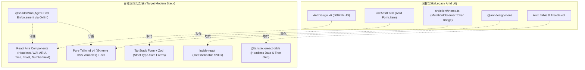

> [!CAUTION]
> **跨 Agent 執行嚴格指令：無論如何都必須先閱讀以下最新官方文件，嚴格禁止依賴模型過往訓練知識！**
>
> 1. **React Aria Components**: https://react-aria.adobe.com/llms.txt
> 2. **shadcn/ui (React Aria Base)**: https://ui.shadcn.com/llms.txt
> 3. **@shadcn/lint (Agent-First Linter)**: https://github.com/shadcn-ui/lint
> 4. **TanStack Form (Type-Safe Forms)**: https://tanstack.com/form/latest
> 5. **Vite+ (Unified Web Toolchain)**: https://viteplus.dev/llms-full.txt

# 前端全面遷移 Master Plan：React Aria + TanStack Form + @shadcn/lint

本主計畫（Master Plan）確立了本站前端從 **Ant Design v6** 全面升級至 **React Aria Components (RAC) + TanStack Form + lucide-react + @shadcn/lint** 的總體技術架構、核心決策與階段性交付規範。

---

## 1. 核心決策與技術選型 (Decisions & Technology Alignment)

依據架構檢討與使用者確認，確立四大技術基石：

1. **UI 底層基底：React Aria Components (RAC) + Tailwind CSS v4**
   - 捨棄傳統黑盒子組件庫，全站採用 Adobe RAC 無障礙基底與標準 WAI-ARIA 模式。
   - 充分利用 RAC 最新能力（v1.7+ 原生之 `Tree` 階層樹、`Toast` 輕量反饋、`NumberField` 數值輸入與無障礙表單整合）。
   - 原子組件採用 **`class-variance-authority` (cva)** 定義類型安全的 Variant 與 Size。
   - 所有元件狀態皆透過 `data-[hovered]`, `data-[pressed]`, `data-[selected]`, `data-[focused]` 與 Tailwind v4 樣式綁定。
   - 視覺圖示全數由 `@ant-design/icons` 替換為現代輕量的 **`lucide-react`**。

2. **表單與表格系統：TanStack Form + TanStack Table + Zod**
   - 本站以「端到端極致型別安全」為核心特色，TanStack 家族具備一致的架構哲學。
   - 表單使用 `@tanstack/react-form` 複用後端 `src/server/routes/*/*.schema.ts` 宣告之 Zod Schema，達成客戶端表單輸入、欄位錯誤檢查與 RPC Wire Payload 的 100% 靜態與運行時型別對齊。
   - 數據表格採用 **`@tanstack/react-table`** 搭配 RAC Table，處理橫向響應式滾動、分頁以及部門樹狀結構展開 (`getSubRows`)。

3. **品質守護系統：@shadcn/lint + Oxlint (Vite+)**
   - 專門為 AI Coding Agent 量身打造的設計系統 Linter。
   - 依據 Vite+ 規範（`https://viteplus.dev/llms-full.txt`），全站 Lint & Fmt 設定完全收攏於根目錄 `vite.config.ts` 的 `lint` 區塊（包含 `jsPlugins`, `settings`, `rules`, `overrides`），嚴禁額外建立 `.oxlintrc.json` 以確保單一配置源（SSOT）。
   - 採先漸進導入（Phase 2 在 `vite.config.ts` 設為 `warn`），待所有組件遷移完成後升級為嚴格攔截（Phase 4 在 `vite.config.ts` 設為 `error`）。

---

## 2. 總體架構演進全景圖



---

## 3. 四階段遷移藍圖 (Phased Roadmap)

|    階段     | 階段主題                       | 核心目標                                                                                                                                                                           | 專屬 Runbook 文件                                              |
| :---------: | :----------------------------- | :--------------------------------------------------------------------------------------------------------------------------------------------------------------------------------- | :------------------------------------------------------------- |
| **Phase 1** | **測試安全網擴充**             | 在觸碰任何 UI 程式碼前，將現有所有系統行為（語系即時切換、登出流程 Mock reload、響應式選單、全域錯誤攔截、表單校驗防呆）用 Vitest Playwright 測試完全鎖死。                        | [Phase 1 執行手冊](./phase1_test_harness_expansion.md)         |
| **Phase 2** | **設計系統與 Linter 基礎建設** | 安裝 RAC、TanStack Form/Table、cva、lucide、@shadcn/lint；設定 `components.json`；在 `vite.config.ts` 中將 `@shadcn/lint` 設為 `warn` 避免阻斷業務；建立健壯的 Form/Toast 適配層。 | [Phase 2 執行手冊](./phase2_design_system_and_linter_setup.md) |
| **Phase 3** | **由底而上分批次組件遷移**     | 嚴格遵守「一次 3~5 個組件、由底層原子至頂層頁面」之節奏，分為 5 個 Batch 逐步替換 Antd 組件（涵蓋 NumberField, TextArea, Tree 等），每批次皆通過 E2E 驗證。                        | [Phase 3 執行手冊](./phase3_bottom_up_component_migration.md)  |
| **Phase 4** | **嚴格守門、清理與文檔收尾**   | 在 `vite.config.ts` 中將 `@shadcn/lint` 提升為 `error`；拔除 `antd` 與 `@ant-design/icons`；清理 `useAntdForm`、`useI18n`、`theme.ts` 與 `providers.tsx`；更新 `canary.test.tsx`。 | [Phase 4 執行手冊](./phase4_enforcement_and_cleanup.md)        |

---

## 4. 全局不可破壞的驗證門禁 (Verification Invariants)

任何階段的 Agent 在提交變更前，**必須** 無條件通過以下本地命令檢查：

```bash
# 1. 內部核心檢查 (TypeScript + Oxlint + Tailwind CSS)
vpr agent:verify:inner

# 2. 端到端完整門禁 (Unit Tests + Build + Playwright Chromium E2E Tests)
vpr agent:verify:gate
```

---

## 5. 遷移前後效能指標基準 (Performance Benchmarks)

| 指標                                | 現狀 (Ant Design v6)        | 遷移後目標 (RAC + Tailwind v4)   | 改善幅度 |
| :---------------------------------- | :-------------------------- | :------------------------------- | :------: |
| **Client 核心 Chunk 體積**          | 608 kB (Gzip: 161 kB)       | < 180 kB (Gzip: ~45 kB)          | **-70%** |
| **UI 樣式計算時間 (Style Recalc)**  | ~35ms (CSS-in-JS injection) | < 5ms (預編譯靜態 CSS)           | **-85%** |
| **無障礙標準相容度**                | 部分自訂 DOM 封裝           | 100% WAI-ARIA 原生標準           | **卓越** |
| **AI 代理防護力 (Linter Feedback)** | 僅語法錯誤                  | 具備語意化 Variant 與 Token 引導 | **頂級** |
