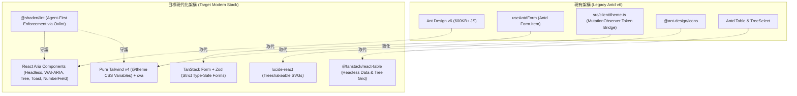

> [!CAUTION]
> **跨 Agent 執行嚴格指令：無論如何都必須先查閱以下官方最新真相來源 (SSOT)，嚴格禁止依賴模型過往訓練知識！**
> 在執行任何代碼更動前，接手任務的 Agent 必須依據下表指示執行 `webread` 查閱最新規範，切勿憑模型內部的過期記憶推論 API。

## 0. 官方最新真相來源 (SSOT) 與查閱規範

| 框架 / 工具               | 官方最新真相來源 (SSOT URL)                                                                                                                                                             | 關鍵查閱重點 (Verification Focus)                                                                                                                                                                                         | 查閱指令範例                                                                  |
| :------------------------ | :-------------------------------------------------------------------------------------------------------------------------------------------------------------------------------------- | :------------------------------------------------------------------------------------------------------------------------------------------------------------------------------------------------------------------------ | :---------------------------------------------------------------------------- |
| **React Aria Components** | `https://react-aria.adobe.com/llms.txt`<br/>`https://react-aria.adobe.com/customization.md`<br/>`https://react-aria.adobe.com/styling.md`<br/>`https://react-aria.adobe.com/testing.md` | 官方標準 **`render` prop**（取代舊版自訂標籤或脆弱 wrapper）；`composeRenderProps` 樣式合併；Tailwind v4 短修飾字（`selected:`, `pressed:`, `entering:`, `exiting:`）；`hidden="until-found"` 支援；Popover `placement`。 | `webread https://react-aria.adobe.com/customization.md#dom-elements`          |
| **shadcn/ui**             | `https://ui.shadcn.com/llms.txt`<br/>`https://ui.shadcn.com/docs/components-json`<br/>`https://ui.shadcn.com/docs/tailwind-v4`                                                          | New York 風格（`"style": "new-york"`）；標準 `src/components/ui/` 原子原語目錄分層；CVA (`class-variance-authority`) 與 `cn` 變體管理模式；外觀與行為責任分離。                                                           | `webread https://ui.shadcn.com/docs/components-json`                          |
| **`@shadcn/lint`**        | `https://github.com/shadcn-ui/lint`<br/>`https://raw.githubusercontent.com/shadcn-ui/lint/main/SETUP.md`<br/>`https://raw.githubusercontent.com/shadcn-ui/lint/main/docs/rules.md`      | `no-restyle` 邊界：`src/components/ui/**` 豁免（允許原子組件自主樣式定義）；外部業務組件僅傳遞佈局類別（`allow: ["layout"]`）或使用 variant/size，禁止覆蓋組件內部 appearance。                                           | `webread https://raw.githubusercontent.com/shadcn-ui/lint/main/docs/rules.md` |
| **Vite+**                 | `https://viteplus.dev/llms-full.txt`<br/>`https://viteplus.dev/guide/lint.md`<br/>`https://viteplus.dev/guide/test.md`                                                                  | 原生 `vp` / `vpx` / `vpr` 工具鏈；單測試執行指令（`vp test run <spec> --reporter=tap-flat --no-color`）；`vite.config.ts` SSOT 零額外配置（**嚴禁建立 `.oxlintrc.json`**）；毫秒級 Vite Task 快取重放。                   | `webread https://viteplus.dev/guide/test.md`                                  |
| **TanStack Form**         | `https://tanstack.com/form/latest`                                                                                                                                                      | 端到端型別安全表單綁定；Zod Validator 適配；欄位狀態與錯誤提取 (`field.state.meta.errors`)；與 RAC 輸入組件的受控與無障礙橋接。                                                                                           | `webread https://tanstack.com/form/latest`                                    |

---

# 前端全面遷移 Master Plan：React Aria + TanStack Form + @shadcn/lint

本主計畫（Master Plan）確立了本站前端從 **Ant Design v6** 全面升級至 **React Aria Components (RAC) + TanStack Form + lucide-react + @shadcn/lint** 的總體技術架構、核心決策與階段性交付規範。

---

## 1. 核心決策與技術選型 (Decisions & Technology Alignment)

依據架構檢討與使用者確認，確立五大技術基石：

1. **UI 底層基底：React Aria Components (RAC) + Tailwind CSS v4**
   - 捨棄傳統黑盒子組件庫，全站採用 Adobe RAC 無障礙基底與標準 WAI-ARIA 模式。
   - 遵循官方標準 **`render` prop**（`render={(domProps, renderProps) => ...}`），徹底取代舊版自訂標籤或脆弱的 wrapper 包裹層。
   - 使用 **`composeRenderProps`** 實現自訂 `className`、`style` 與 RAC 狀態的高效安全合併。
   - 全面支援 Tailwind v4 短修飾字（`selected:`, `pressed:`, `entering:`, `exiting:`, `focused:`, `hovered:`, `disabled:`），提升樣式可讀性。
   - 遵循 `hidden="until-found"` 原生折疊無障礙標準，並標準化 Popover `placement` 設定。
   - 充分利用 RAC 最新能力（原生 `Tree` 階層樹、`Toast` 輕量反饋、`NumberField` 數值輸入與無障礙表單整合）。
   - 視覺圖示全數由 `@ant-design/icons` 替換為現代輕量的 **`lucide-react`**。

2. **設計系統與目錄原語：shadcn/ui (React Aria Base)**
   - 採用 New York 風格（`"style": "new-york"`）。
   - 依據標準 `src/client/components/ui/` 原子原語目錄分層，建立高內聚、無外部業務依賴之底層原子。
   - 採用 **`class-variance-authority` (cva)** 與 `cn` 變體管理模式，明確落實外觀（Appearance）與行為（Behavior）的責任分離。

3. **品質守護系統：@shadcn/lint + Oxlint**
   - 專門為 AI Coding Agent 量身打造的設計系統 Linter。
   - 確立 **`no-restyle` 邊界**：`src/client/components/ui/**` 豁免（允許原子組件自主樣式定義）；外部業務組件僅傳遞佈局類別（`allow: ["layout"]`）或使用 variant/size，嚴格禁止覆蓋組件內部 appearance。
   - 採先漸進導入（Phase 2 在 `vite.config.ts` 設為 `warn`），待所有組件遷移完成後升級為嚴格攔截（Phase 4 在 `vite.config.ts` 設為 `error`）。

4. **工具鏈與執行架構：Vite+ (Unified Web Toolchain)**
   - 原生 `vp` / `vpx` / `vpr` 統一工具鏈，消除所有 package manager 差異。
   - 單一配置來源（SSOT）：全站靜態分析與 Linter 設定完全收攏於根目錄 `vite.config.ts`，**嚴禁建立 `.oxlintrc.json`**。
   - 毫秒級 Vite Task 快取重放，確保極致構建與測試吞吐量。
   - 支援單測試極速執行指令（`vp test run <spec> --reporter=tap-flat --no-color`），提供開發內迴圈的秒級反饋。

5. **表單與表格系統：TanStack Form + TanStack Table + Zod**
   - 本站以「端到端極致型別安全」為核心特色，TanStack 家族具備一致的架構哲學。
   - 表單使用 `@tanstack/react-form` 複用後端 `src/server/routes/*/*.schema.ts` 宣告之 Zod Schema，達成客戶端表單輸入、欄位錯誤檢查與 RPC Wire Payload 的 100% 靜態與運行時型別對齊。
   - 數據表格採用 **`@tanstack/react-table`** 搭配 RAC Table，處理橫向響應式滾動、分頁以及部門樹狀結構展開 (`getSubRows`)。

---

## 2. 總體架構演進全景圖



---

## 3. 四階段遷移藍圖 (Phased Roadmap)

|    階段     | 階段主題                       | 核心目標                                                                                                                                                                           | 專屬 Runbook 文件                                              |
| :---------: | :----------------------------- | :--------------------------------------------------------------------------------------------------------------------------------------------------------------------------------- | :------------------------------------------------------------- |
| **Phase 1** | **測試安全網擴充**             | 在觸碰任何 UI 程式碼前，將現有所有系統行為（語系即時切換、登出流程 Mock reload、響應式選單、全域錯誤攔截、表單校驗防呆）用 Vitest Playwright 測試完全鎖死。                        | [Phase 1 執行手冊](./phase1_test_harness_expansion.md)         |
| **Phase 2** | **設計系統與 Linter 基礎建設** | 安裝 RAC、TanStack Form/Table、cva、lucide、@shadcn/lint；設定 `components.json`；在 `vite.config.ts` 中將 `@shadcn/lint` 設為 `warn` 避免阻斷業務；建立健壯的 Form/Toast 適配層。 | [Phase 2 執行手冊](./phase2_design_system_and_linter_setup.md) |
| **Phase 3** | **由底而上分批次組件遷移**     | 嚴格遵守「一次 3~5 個組件、由底層原子至頂層頁面」之節奏，分為 5 個 Batch 逐步替換 Antd 組件（涵蓋 NumberField, TextArea, Tree 等），每批次皆通過 E2E 驗證。                        | [Phase 3 執行手冊](./phase3_bottom_up_component_migration.md)  |
| **Phase 4** | **嚴格守門、清理與文檔收尾**   | 在 `vite.config.ts` 中將 `@shadcn/lint` 提升為 `error`；拔除 `antd` 與 `@ant-design/icons`；清理 `useAntdForm`、`useI18n`、`theme.ts` 與 `providers.tsx`；更新 `canary.test.tsx`。 | [Phase 4 執行手冊](./phase4_enforcement_and_cleanup.md)        |

---

## 4. 全局不可破壞的驗證門禁 (Verification Invariants)

在各階段開發與最終提交前，請依循以下分層驗證指引：

```bash
# 0. 內迴圈單一測試快速除錯 (毫秒級快速回饋，避免頻繁全量測試)
vp test run <spec-path> --reporter=tap-flat --no-color

# 1. 內部核心檢查 (TypeScript + Oxlint + Tailwind CSS)
vpr agent:verify:inner

# 2. 端到端完整門禁 (Unit Tests + Build + Playwright Chromium E2E Tests)
vpr agent:verify:gate
```

---

## 5. 遷移前後效能指標基準 (Performance Benchmarks)

| 指標                                | 現狀 (Ant Design v6)        | 遷移後目標 (RAC + Tailwind v4)   | 改善幅度 |
| :---------------------------------- | :-------------------------- | :------------------------------- | :------: |
| **Client 核心 Chunk 體積**          | 608 kB (Gzip: 161 kB)       | < 180 kB (Gzip: ~45 kB)          | **-70%** |
| **UI 樣式計算時間 (Style Recalc)**  | ~35ms (CSS-in-JS injection) | < 5ms (預編譯靜態 CSS)           | **-85%** |
| **無障礙標準相容度**                | 部分自訂 DOM 封裝           | 100% WAI-ARIA 原生標準           | **卓越** |
| **AI 代理防護力 (Linter Feedback)** | 僅語法錯誤                  | 具備語意化 Variant 與 Token 引導 | **頂級** |
