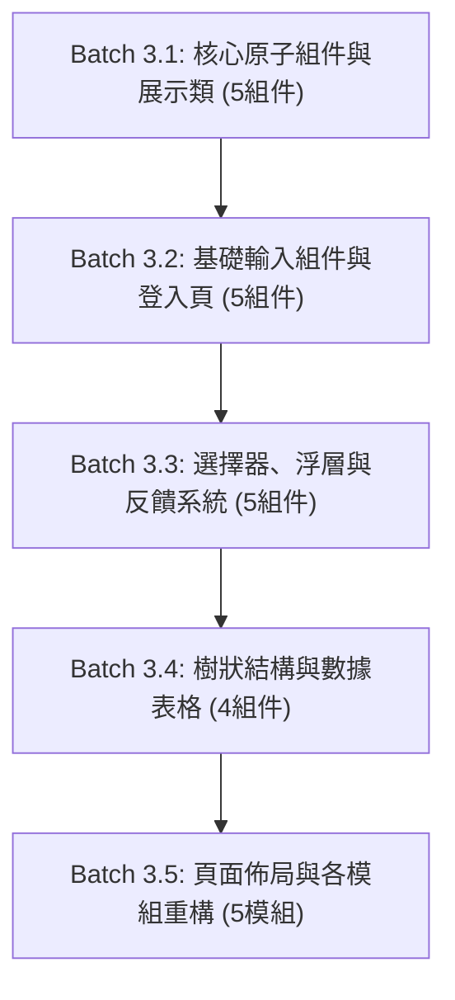

> [!CAUTION]
> **跨 Agent 執行嚴格指令：無論如何都必須先查閱以下官方最新真相來源 (SSOT)，嚴格禁止依賴模型過往訓練知識！**
> 在執行任何代碼更動前，接手任務的 Agent 必須依據下表指示執行 `webread` 查閱最新規範，切勿憑模型內部的過期記憶推論 API。

## 0. 官方最新真相來源 (SSOT) 與查閱規範

| 框架 / 工具                  | 官方最新真相來源 (SSOT URL)                                                                                                                                                             | 關鍵查閱重點 (Verification Focus)                                                                                                                                                                                         | 查閱指令範例                                                                  |
| :--------------------------- | :-------------------------------------------------------------------------------------------------------------------------------------------------------------------------------------- | :------------------------------------------------------------------------------------------------------------------------------------------------------------------------------------------------------------------------ | :---------------------------------------------------------------------------- |
| **React Aria Components**    | `https://react-aria.adobe.com/llms.txt`<br/>`https://react-aria.adobe.com/customization.md`<br/>`https://react-aria.adobe.com/styling.md`<br/>`https://react-aria.adobe.com/testing.md` | 官方標準 **`render` prop**（取代舊版自訂標籤或脆弱 wrapper）；`composeRenderProps` 樣式合併；Tailwind v4 短修飾字（`selected:`, `pressed:`, `entering:`, `exiting:`）；`hidden="until-found"` 支援；Popover `placement`。 | `webread https://react-aria.adobe.com/customization.md#dom-elements`          |
| **shadcn/ui**                | `https://ui.shadcn.com/llms.txt`<br/>`https://ui.shadcn.com/docs/components-json`<br/>`https://ui.shadcn.com/docs/tailwind-v4`                                                          | New York 風格（`"style": "new-york"`）；標準 `src/components/ui/` 原子原語目錄分層；CVA (`class-variance-authority`) 與 `cn` 變體管理模式；外觀與行為責任分離。                                                           | `webread https://ui.shadcn.com/docs/components-json`                          |
| **`@shadcn/lint`**           | `https://github.com/shadcn-ui/lint`<br/>`https://raw.githubusercontent.com/shadcn-ui/lint/main/SETUP.md`<br/>`https://raw.githubusercontent.com/shadcn-ui/lint/main/docs/rules.md`      | `no-restyle` 邊界：`src/components/ui/**` 豁免（允許原子組件自主樣式定義）；外部業務組件僅傳遞佈局類別（`allow: ["layout"]`）或使用 variant/size，禁止覆蓋組件內部 appearance。                                           | `webread https://raw.githubusercontent.com/shadcn-ui/lint/main/docs/rules.md` |
| **Vite+**                    | `https://viteplus.dev/llms-full.txt`<br/>`https://viteplus.dev/guide/lint.md`<br/>`https://viteplus.dev/guide/test.md`                                                                  | 原生 `vp` / `vpx` / `vpr` 工具鏈；單測試執行指令（`vp test run <spec> --reporter=tap-flat --no-color`）；`vite.config.ts` SSOT 零額外配置（**嚴禁建立 `.oxlintrc.json`**）；毫秒級 Vite Task 快取重放。                   | `webread https://viteplus.dev/guide/test.md`                                  |
| **React Compiler**           | `https://react.dev/learn/react-compiler`<br/>`https://react.dev/reference/react/useMemo`                                                                                                | React 19 自動 memoization (`react({ compiler: true })`)；零冗餘手動 `useMemo`/`useCallback`；嚴守 Rules of React（禁止 render 內 mutate、禁止 render 內宣告巢狀組件）。                                                   | `webread https://react.dev/learn/react-compiler`                              |
| **Tailwind CSS v4 & Linter** | `https://tailwindcss.com/docs`<br/>`scripts/lint-tailwind.ts`                                                                                                                           | Tailwind v4 Canonical Classes（如 `stroke-3` 取代 `stroke-[3]`）；CSS 變數動態寬度 (`w-(--col-w)`)；嚴禁行內 `style={{}}`；執行 `vpr lint:tailwind` 與 `vpr lint:tailwind:fix`。                                          | `vpr lint:tailwind --help`                                                    |
| **TanStack Form & Table**    | `https://tanstack.com/form/latest`<br/>`https://tanstack.com/table/latest`                                                                                                              | 端到端型別安全表單綁定；TanStack Table v9 `createTableHook` + `tableFeatures` 架構；`columnVisibilityFeature`；樹狀縮排與折疊展開；頂層 columns 構建避開 nested component 報錯。                                          | `webread https://tanstack.com/form/latest`                                    |

---

# Phase 3 執行手冊：由底而上分批次組件遷移

## 1. 階段目標與核心理念

本階段為遷移的**核心實施階段**。依循使用者指示，嚴格貫徹「**一次 3~5 個組件、由底而上 (Bottom-Up)、降低程式碼漂移**」的原則。

每個批次皆必須具備高內聚性：

- 撰寫與調整代碼時，優先使用 Vite+ 單測試指令 `vp test run <spec> --reporter=tap-flat --no-color` 獲得毫秒級極速回饋。
- 每批次完成後，**必須立即執行 `vpr agent:verify:gate`**，以確認該批次改動零破壞、測試全數綠燈，再進行下一批次。

---

## 2. 批次遷移藍圖總覽



---

## 3. 原子組件標準實作模式 (RAC Standard Component Pattern)

在實作 `src/client/components/ui/` 底層組件時，**必須** 嚴格遵循以下官方標準範例：

```tsx
import {
  Button as RACButton,
  type ButtonProps as RACButtonProps,
  composeRenderProps,
} from "react-aria-components";
import { cva, type VariantProps } from "class-variance-authority";
import { cn } from "../../utils/cn.ts";

export const buttonVariants = cva(
  "inline-flex items-center justify-center rounded-md text-sm font-medium transition-colors focus-visible:outline-none focus-visible:ring-2 focus-visible:ring-ring disabled:pointer-events-none disabled:opacity-50",
  {
    variants: {
      variant: {
        default: "bg-primary text-primary-foreground hover:bg-primary/90 pressed:bg-primary/80",
        destructive:
          "bg-destructive text-destructive-foreground hover:bg-destructive/90 pressed:bg-destructive/80",
        outline: "border border-input bg-background hover:bg-muted pressed:bg-muted/80",
        ghost: "hover:bg-muted pressed:bg-muted/80",
        link: "text-primary underline-offset-4 hover:underline",
      },
      size: {
        default: "h-9 px-4 py-2",
        sm: "h-8 rounded-md px-3 text-xs",
        lg: "h-10 rounded-md px-8",
        icon: "h-9 w-9",
      },
    },
    defaultVariants: {
      variant: "default",
      size: "default",
    },
  },
);

export interface ButtonProps extends RACButtonProps, VariantProps<typeof buttonVariants> {}

export function Button({ className, variant, size, ...props }: ButtonProps) {
  return (
    <RACButton
      {...props}
      /* 使用 composeRenderProps 合併自訂 className 與 RAC 狀態 */
      className={composeRenderProps(className, (cls, renderProps) =>
        cn(buttonVariants({ variant, size, className: cls })),
      )}
    />
  );
}
```

> [!IMPORTANT]
> **核心設計約束**：
>
> 1. **官方標準 `render` prop**：當需要變更底層 DOM 元素（如 Motion 動畫按鈕）時，使用 RAC 官方的 `render={(domProps, renderProps) => <motion.button ... />}`，嚴禁使用舊版自訂標籤或脆弱的外部 wrapper。
> 2. **Tailwind v4 短修飾字**：優先使用 RAC 原生短修飾字（`pressed:`, `hovered:`, `selected:`, `focused:`, `entering:`, `exiting:`），提高樣式簡潔度。
> 3. **`no-restyle` 邊界遵從**：`src/client/components/ui/` 內享有 appearance 定義權；外部業務頁面調用時，僅能傳遞佈局類別（如 `w-full`, `mt-4`）或透過 `variant`/`size` prop 切換樣式，**嚴禁覆蓋組件內部外觀（如背景色、邊框色）**。
> 4. **React Compiler 自動 Memoization**：專案開啟 `react({ compiler: true })`。信任 React Compiler，**嚴禁撰寫多餘的 `useMemo` 或 `useCallback`** 除非涉及非 React 外部系統訂閱。衍生狀態（Derived State）直接於 render 頂層以純運算表達；嚴禁在 render 期間 mutate 變數或動態宣告組件（避免觸發 `react/no-unstable-nested-components`）。
> 5. **Tailwind CSS v4 語法與 Linter 驗證**：
>    - 使用規範的 Canonical Classes，例如使用 `stroke-3` 取代 `stroke-[3]`，避免任意值 class。
>    - 嚴禁行內 `style={{ ... }}`；動態寬度或變數應使用 CSS 變數橋接搭配 Tailwind 任意屬性（如 `style={{"--col-w": "100px"}}` 與 class `w-(--col-w)`）。
>    - 開發與修改組件後，必須執行 `vpr lint:tailwind` 檢查（可用 `vpr lint:tailwind:fix` 自動修復）。
> 6. **Strict TypeScript & `exactOptionalPropertyTypes`**：
>    - 嚴禁未受限泛型強制轉型（`as unknown as T`），透過型別守衛或寬鬆參數定義消除 `typescript/no-unsafe-type-assertion`。
>    - `exactOptionalPropertyTypes: true` 環境下，可選屬性嚴禁傳遞 `{ prop: undefined }`，一律使用條件擴展 `{...(prop !== undefined ? { prop } : {})}`。

---

## 4. 各批次詳細遷移規範

### Batch 3.1: 核心展示與原子組件 (Atoms & Display)

- **目標組件清單（5 個）**：
  1. `ui/button.tsx`：RAC `Button` + `cva` variants (`default`, `destructive`, `outline`, `ghost`, `link`) 與 sizes (`sm`, `md`, `lg`)，使用 `composeRenderProps` 與 Tailwind v4 短修飾字（`hovered:`, `pressed:`, `disabled:`）實作。
  2. `components/PermissionButton.tsx`：將原本 Antd Button 改為封裝上述 RAC Button，維持 RBAC 權限判斷（無權限時 `hide` 或 `disable`）。
  3. `ui/badge.tsx`：取代 Antd `Tag`，提供 `default`, `primary`, `success`, `error`, `gold` 等語意色彩變體（用於 UserTable 的狀態與 System 標籤）。
  4. `ui/card.tsx`：純 Tailwind v4 卡片組件（`Card`, `CardHeader`, `CardTitle`, `CardDescription`, `CardContent`, `CardFooter`）。
  5. `components/I18nSwitcher.tsx` & `src/client/constants/routes.tsx`：
     - `I18nSwitcher`：使用 RAC `MenuTrigger`, `Menu`, `MenuItem`, `Popover` (支援 `placement="bottom end"`) 替換 Antd Dropdown，並以 `lucide-react` 的 `Globe` 替換 `GlobalOutlined`。
     - `constants/routes.tsx`：將選單項目的 Antd 圖示 (`ApartmentOutlined`, `SafetyCertificateOutlined`, `TeamOutlined`) 替換為 `lucide-react` 的 `Network`, `ShieldCheck`, `Users`。
- **驗證指標**：
  - 開發時可執行單測試：`vp test run test/client/e2e-i18n.test.tsx --reporter=tap-flat --no-color`
  - 確保 `vpr agent:test:e2e` 中 `e2e-i18n.test.tsx` 與既有 RBAC 測試順利通過。

> [!TIP]
> **Batch 3.1 移交確認**：`Button`, `PermissionButton`, `Badge`, `Card`, `I18nSwitcher` 與 `routes.tsx` 圖示已無 Antd 依賴，`vpr agent:verify:gate` 100% 通過。
>
> **Batch 3.2 啟動 Prompt**：
>
> ```markdown
> 請繼續執行前端遷移 Phase 3 的 Batch 3.2（基礎輸入組件與登入頁面）。
> 請先查閱 `docs/migration/README.md` 第 0 節 SSOT 對照表與 `docs/migration/phase3_bottom_up_component_migration.md` 中 Batch 3.2 規範。
> 目標：實作 `ui/textfield.tsx`（含 TextArea）、`ui/password-input.tsx`、`ui/number-field.tsx`、`ui/radio-group.tsx`，並將 `src/client/routes/login.tsx` 重構為 TanStack Form。
> 遵循 RAC `composeRenderProps` 與短修飾字標準，優先使用 `vp test run test/client/canary.test.tsx --reporter=tap-flat --no-color` 快速除錯，完成後執行 `vpr agent:verify:gate` 確保全綠。
> ```

---

### Batch 3.2: 基礎輸入組件與登入頁面 (Inputs & Login Flow)

- **目標組件清單（5 個）**：
  1. `ui/textfield.tsx` (`ui/input.tsx`)：RAC `TextField`, `Input`, 以及 `TextArea`（供角色描述欄位使用），支援 `focused:`, `invalid:` 狀態。
  2. `ui/password-input.tsx`：帶有 `lucide-react` `Eye` / `EyeOff` 切換的密碼輸入框。
  3. `ui/number-field.tsx`：RAC `NumberField`, `Group`, `Input`, `Button`（供部門與角色表單的「排序」欄位使用）。
  4. `ui/radio-group.tsx`：RAC `RadioGroup`, `Radio`（供人員狀態與角色資料範圍選擇），支援 `selected:` 短修飾字。
  5. **頁面重構**：`src/client/routes/login.tsx`：
     - 移除 Antd `Form`, `Input`, `Button`, `Card`。
     - 採用 TanStack Form 綁定 `LoginReqSchema`，並以上述組件渲染。
- **驗證指標**：
  - 開發時可執行單測試：`vp test run test/client/e2e-auth-flow.test.tsx --reporter=tap-flat --no-color`
  - `vpr agent:test:e2e` 確保登入流程與 Wire Contract 測試 100% 通過。

> [!TIP]
> **Batch 3.2 移交確認**：登入頁已切換為 TanStack Form + RAC，`canary.test.tsx` 與登入測試通過，`vpr agent:verify:gate` 100% 通過。
>
> **Batch 3.3 啟動 Prompt**：
>
> ```markdown
> 請繼續執行前端遷移 Phase 3 的 Batch 3.3（選擇器、浮層與反饋系統）。
> 請先查閱 `docs/migration/README.md` 第 0 節 SSOT 對照表與 `docs/migration/phase3_bottom_up_component_migration.md` 中 Batch 3.3 規範。
> 目標：實作 `ui/select.tsx`（含 MultiSelect）、`DataModal.tsx`、`DataDrawer.tsx`、`ui/popconfirm.tsx`，以及以 RAC `ToastQueue` 實作的 `ui/toast.tsx`，並在 `providers.tsx` 掛載 `<ToastRegion>`。
> 注意 Popover `placement` 設定與 `hidden="until-found"` 原生無障礙折疊標準，開發時使用單測試指令快速驗證，完成後執行 `vpr agent:verify:gate` 確保全綠。
> ```

---

### Batch 3.3: 選擇器、浮層與反饋系統 (Selects, Overlays & Feedback)

- **目標組件清單（5 個）**：
  1. `ui/select.tsx`：
     - 單選：RAC `Select`, `Button`, `SelectValue`, `Popover` (支援 `placement="bottom start"`), `ListBox`, `ListBoxItem`。
     - 多選：封裝 `MultiSelect` / `TagPicker`（供 `UserModal` 選擇多個角色 `roleIds` 使用）。
  2. `components/common/DataModal.tsx`：使用 RAC `ModalOverlay`, `Modal`, `Dialog` 封裝，相容原有 `open`, `title`, `onCancel`, `onOk`, `confirmLoading` 介面，並以 `lucide-react` `X` 作為關閉按鈕，內建 `hidden="until-found"` 原生無障礙折疊。
  3. `components/common/DataDrawer.tsx`：使用 RAC `Sheet` 或右側 slide-in `Modal` 實作右側滑出抽屜，相容 `open`, `title`, `onClose`, `extra` 介面。
  4. `ui/popconfirm.tsx`：使用 RAC `DialogTrigger` + `Popover` + `Button` 封裝氣泡確認框，相容原有確認/取消行為。
  5. `ui/toast.tsx` (`src/client/utils/toast.ts`)：
     - 封裝基於 RAC `ToastQueue` 的通知浮層系統，在 `src/client/providers.tsx` 掛載 `<ToastRegion>`。
     - 替換 React Query 與 hooks 中對 Antd `App.useApp().message.error()` 與 `message.success()` 的依賴。
- **驗證指標**：
  - 開發時可執行單測試：`vp test run test/client/e2e-layout.test.tsx --reporter=tap-flat --no-color`
  - 驗證 Modal 開啟、抽屜滑出、Popconfirm 氣泡點擊、Toast 彈出皆符合原本行為。

> [!TIP]
> **Batch 3.3 移交確認**：浮層與反饋系統皆已就緒且相容既有調用，Toast 通知正常，`vpr agent:verify:gate` 100% 通過。
>
> **Batch 3.4 啟動 Prompt**：
>
> ```markdown
> 請繼續執行前端遷移 Phase 3 的 Batch 3.4（樹狀結構與數據表格）。
> 請先查閱 `docs/migration/README.md` 第 0 節 SSOT 對照表與 `docs/migration/phase3_bottom_up_component_migration.md` 中 Batch 3.4 規範。
> 目標：實作可勾選之階層樹 `ui/tree.tsx`、下拉選擇器 `ui/tree-select.tsx`，並結合 `@tanstack/react-table` 與 RAC Table 打造 `DataTable.tsx` 與樹狀展開表格 `DepartmentTreeTable.tsx`。
> 開發時善用 `vp test run test/client/e2e-departments.test.tsx --reporter=tap-flat --no-color` 獲得快速反饋，完成後執行 `vpr agent:verify:gate` 確保全綠。
> ```

---

### Batch 3.4: 樹狀結構與數據表格 (Trees & Tables)

- **目標組件清單（4 個核心組件 + 1 個原子原語）**：
  1. `ui/checkbox.tsx` (補充原子原語)：RAC 原生 `Checkbox`，搭配 `lucide-react` `Check` / `Minus`，內部裝飾容器加註 `pointer-events-none`，採用 Tailwind Canonical Class `stroke-3`。
  2. `ui/tree.tsx`：使用 RAC `Tree` (v1.7+) + `Checkbox` 實作可勾選的多選階層樹，支援宣告式 `treeData` 遞迴、`defaultExpandAll`、`checkedKeys` 雙向綁定與鍵值類型自適應，用於 `RoleDrawer` 中的權限樹勾選 (`PermissionTreeInput`)。
  3. `ui/tree-select.tsx`：使用 RAC `Popover` + RAC `Tree` 自製下拉樹狀選擇器，支援部門階層單選（上級部門）與多選（自訂資料權限之自訂部門），支援 `allowClear` 與靜態相容常數 `TreeSelect.SHOW_ALL`。
  4. `components/common/DataTable.tsx`：結合 RAC `Table` 與 `@tanstack/react-table` (v9)，支援 `max-content` 響應式橫向捲動、載入中遮罩、首欄樹狀層級深度縮排（Tailwind class `pl-6`, `pl-12`, `pl-18`）與折疊展開按鈕。
  5. `components/department/DepartmentTreeTable.tsx`：基於 TanStack Table 樹狀展開結構 (`getSubRows`) 實現部門階層展開與摺疊，全面移除 Antd Table 與 Space。
- **關鍵踩坑與實戰解決方案 (Lessons Learned)**：
  1. **TanStack Table v9 核心架構**：
     - 專案依賴 `@tanstack/react-table: 9.3.1`，必須使用 `createTableHook` 綁定 `features`（`tableFeatures({ columnVisibilityFeature, rowExpandingFeature, expandedRowModel: createExpandedRowModel(), ... })`）。
     - 行渲染必須依賴 `row.getAllCells()`，未註冊 `columnVisibilityFeature` 會導致 `getVisibleCells` 運行時缺失。
     - 欄位定義產生器 `buildTanstackColumns` 必須宣告於組件頂層，嚴禁在組件 render 期間透過 `useMemo` 動態回傳內聯組件，避免違反 `react/no-unstable-nested-components`。
  2. **React Compiler 自動 Memoization 協作**：
     - 專案配置 Vite React 插件 `compiler: true`。組件內部衍生狀態（如選中標籤、樹狀節點轉化）應直接於 render 頂層以純運算表達，避免手動包裹冗餘的 `useMemo`，信任編譯器自動細粒度快取。
     - 嚴格維持組件為純函數，不可在 render 期間 mutate 任何外部狀態或對象。
  3. **Tailwind CSS v4 Linter 與樣式標準**：
     - 圖示筆觸寬度嚴禁使用任意值 `stroke-[3]`，必須使用 Tailwind v4 Canonical Class `stroke-3`。
     - 欄寬動態計算嚴禁使用行內 `style={{ width }}`，統一使用 CSS 變數 `--col-w` 搭配 Tailwind class `w-(--col-w)` 與條件展開 `{...(widthStyle !== undefined ? { style: widthStyle } : {})}`。
     - 任何 UI 組件變動後，必須跑 `vpr lint:tailwind`（或 `vpr lint:tailwind:fix` 自動修復）。
  4. **Strict TypeScript & `exactOptionalPropertyTypes`**：
     - 泛型表單回調 `onChange` 應避免 `as unknown as T`，防止觸發 `typescript/no-unsafe-type-assertion`。
     - 表格設定物件（如 `appTableOptions.initialState`）在型別定義上為 readonly，必須在物件初始化宣告時以三元運算子決定，嚴禁宣告後再去賦值。
  5. **RAC Table & Playwright 無障礙角色差異**：
     - RAC `Table` 產出的 `<table>` 元素帶有 `role="grid"`，在 Vitest Browser 測試中需使用 `getByRole("grid")` 查詢。
     - Checkbox 與 TreeItem 文字必須加註 `pointer-events-none` 避免 Playwright 點擊穿透判定被阻擋。
- **驗證指標**：
  - 組件單元測試：`vp test run test/client/ui-trees-and-tables.test.tsx --reporter=tap-flat --no-color` (4/4 通過)
  - 部門 E2E 測試：`vp test run test/client/e2e-departments.test.tsx --reporter=tap-flat --no-color` (5/5 通過)
  - 全站測試門禁：`vpr agent:verify:gate` 全部通過 (Unit 28/28, E2E 40/40, Build 100% 綠燈)。

> [!TIP]
> **Batch 3.4 移交確認**：數據表格與階層樹全部通過瀏覽器 E2E 測試驗證，`DataTableColumn` 已向下相容 `RoleTable` 與 `UserTable`，`vpr agent:verify:gate` 100% 通過。
>
> **Batch 3.5 啟動 Prompt**：
>
> ```markdown
> 請繼續執行前端遷移 Phase 3 的 Batch 3.5（頁面佈局與各模組重構）。
> 請先查閱 `docs/migration/README.md` 第 0 節 SSOT 對照表與 `docs/migration/phase3_bottom_up_component_migration.md` 中 Batch 3.5 規範。
> 目標：重構 `Layout.tsx` 為標準語意 HTML5 + Tailwind 導航；重構 Department, Role, User 業務頁面與對應 Modal/Drawer；重構 403 頁面與首頁空看板；將所有 Antd `<Flex>` 與 `<Space>` 替換為 Tailwind 工具類。
> 嚴格遵守 `@shadcn/lint` 的 `no-restyle` 邊界：業務頁面僅傳遞佈局類別（`allow: ["layout"]`）或使用 variant/size，禁止覆蓋 appearance。
> 特別注意：
>
> 1. 專案具備 React Compiler (`compiler: true`)，請直接撰寫乾淨純粹的衍生狀態，避免冗餘的 `useMemo`/`useCallback`。
> 2. 隨時執行 `vpr lint:tailwind` 確保無任意值樣式。
> 3. 欄位定義需符合 Batch 3.4 定義之 `DataTableColumn<T>` 標準。
>    完成後執行 `vpr agent:verify:gate` 確保全站業務功能零退化。
> ```

---

### Batch 3.5: 頁面佈局與各模組重構 (Layout & Management Views)

- **目標組件清單（5 個模組/頁面）**：
  1. `components/Layout.tsx`：
     - 移除 `AntdLayout`, `Header`, `Sider`, `Menu`, `Typography`。
     - 使用標準 `<header>`, `<aside>`, `<main>` 配合 Tailwind v4 打造響應式側邊導航，Icon 全面採用 `lucide-react` (`Users`, `ShieldCheck`, `Network`, `LogOut`, `Menu`, `ChevronLeft`, `ChevronRight`)。
  2. `src/client/routes/departments.tsx` & `components/department/DepartmentModal.tsx`：切換為 TanStack Form + RAC Modal/NumberField/TreeSelect。將所有 Antd `<Flex>` 與 `<Space>` 替換為 Tailwind Flex 工具類別。
  3. `src/client/routes/roles.tsx` & `components/role/*`：切換為 TanStack Form + RAC Drawer/Table/Tree。
  4. `src/client/routes/user.tsx` & `components/user/*`：切換為 TanStack Form + RAC Modal/Table/MultiSelect。
  5. `src/client/routes/403.tsx` & `src/client/routes/index.tsx`：
     - `403.tsx`：以純 Tailwind 卡片與 `ShieldAlert` 圖示重構，移除 Antd `Result`。
     - `index.tsx`：以純 Tailwind 居中容器展示系統 Logo 與灰階空看板，移除 Antd `Empty`。
- **邊界約束**：遵守 `@shadcn/lint` 的 `no-restyle` 邊界，業務頁面中禁止覆蓋組件內部外觀 class。
- **驗證指標**：
  - 開發時可執行各單項測試：`vp test run test/client/e2e-roles.test.tsx --reporter=tap-flat --no-color`
  - 執行全站 E2E 測試，確保所有業務管理頁面功能無損。

---

## 5. Phase 3 驗收標準 (Acceptance Gate)

完成所有批次後，專案原始碼中除未移除的過渡依賴外，業務頁面已無任何 Antd 組件呼叫：

```bash
# 0. 內迴圈針對修改模組進行極速單測試
vp test run <spec-path> --reporter=tap-flat --no-color

# 1. 內部核心檢查 (TypeScript + Oxlint + Tailwind CSS)
vpr agent:verify:inner

# 2. 全門禁驗收
vpr agent:verify:gate
```

驗收合格後，Phase 3 Agent 即可將代碼移交至 Phase 4 進行依賴清理與規範收束。

---

## 6. 階段結束確認事項與 Phase 4 啟動指令 (Handover & Next Phase Activation)

### 6.1 移交前確認事項 (Pre-flight Checklist)

請在結束當前 Phase 3 對話前，逐一核對以下檢查項目：

- [ ] 5 個 Batch 的組件與頁面皆已全數替換為 RAC + TanStack Form + Tailwind v4。
- [ ] 業務頁面（`routes/` 與 `components/`）已無任何使用中的 Antd 組件（如 `Button`, `Form`, `Table`, `Modal`, `Drawer`, `Select`, `Input`, `TreeSelect`, `Card`, `Flex`, `Space`, `Result`, `Empty`）。
- [ ] 全域 Toast 系統已接管所有通知需求。
- [ ] 執行 `vpr agent:verify:gate`，所有單元與 E2E 測試 100% 綠燈通過。
- [ ] 產生英文 Conventional Commit 建議並由使用者在本地終端機完成提交。

### 6.2 Phase 4 啟動 Prompt (供使用者複製至全新 Agent 對話)

```markdown
請擔任前端現代化遷移的 Phase 4 負責 Agent。

請先依序閱讀以下文件以建立上下文與最新 API 真相來源：

1. `docs/migration/README.md`（查閱第 0 節 SSOT 對照表）
2. `docs/migration/phase4_enforcement_and_cleanup.md`
3. 使用 `webread` 查閱官方最新真相來源：
   - @shadcn/lint: `webread https://raw.githubusercontent.com/shadcn-ui/lint/main/docs/rules.md`
   - Vite+: `webread https://viteplus.dev/guide/test.md`
   - React Aria Testing: `webread https://react-aria.adobe.com/testing.md`

【當前狀態】
Phase 1、Phase 2 與 Phase 3（5 個 Batch）已全數完成，所有業務頁面皆已現代化，E2E 測試 100% 綠燈。

【本次任務目標】
執行 Phase 4「嚴格守門、清理與文檔收尾」：

1. 將 `vite.config.ts` 的 `lint` 區塊中的 `@shadcn/lint` 規則等級正式提升為 `error`。
2. 徹底卸載套件：`vp remove antd @ant-design/icons`。
3. 刪除與簡化過渡檔案：
   - 刪除 `src/client/hooks/useAntdForm.ts`。
   - 清理 `src/client/hooks/useI18n.ts`（移除 `antdLocales` 與 Antd 語系引入）。
   - 簡化 `src/client/theme.ts`（移除 `createAntdTheme`、`useAntdTheme` 與 `MutationObserver`）。
   - 簡化 `src/client/providers.tsx`（移除 `AntdProvider`, `ConfigProvider`, `App` 並掛載 `ToastRegion`）。
4. 適配 `test/client/canary.test.tsx`（測試對象轉移至 RAC Button）。
5. 同步專案規範文件（`AGENTS.md`, `.agents/rules/ui-styling.md`, `.agents/skills/scaffold-feature/SKILL.md`）。
6. 通過全門禁驗證後，刪除 `docs/migration/` 目錄。
```
