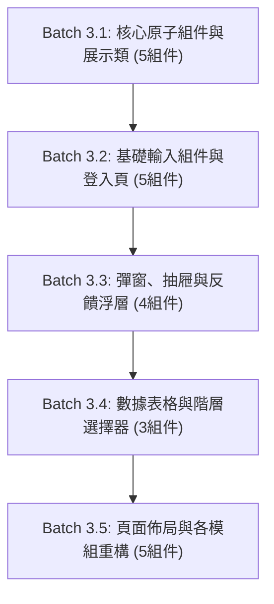

> [!CAUTION]
> **跨 Agent 執行嚴格指令：無論如何都必須先閱讀以下最新官方文件，嚴格禁止依賴模型過往訓練知識！**
>
> 1. **React Aria Components**: https://react-aria.adobe.com/llms.txt
> 2. **shadcn/ui (React Aria Base)**: https://ui.shadcn.com/llms.txt
> 3. **@shadcn/lint (Agent-First Linter)**: https://github.com/shadcn-ui/lint
> 4. **TanStack Form (Type-Safe Forms)**: https://tanstack.com/form/latest

# Phase 3 執行手冊：由底而上分批次組件遷移

## 1. 階段目標與核心理念

本階段為遷移的**核心實施階段**。依循使用者指示，嚴格貫徹「**一次 3~5 個組件、由底而上 (Bottom-Up)、降低程式碼漂移**」的原則。

每個批次皆必須具備高內聚性，且在每批次完成後，**必須立即執行 `vpr agent:verify:gate`**，以確認該批次改動零破壞、測試全數綠燈，再進行下一批次。

---

## 2. 批次遷移藍圖總覽



---

## 3. 各批次詳細遷移規範

### Batch 3.1: 核心展示與原子組件 (Atoms & Display)

- **目標組件清單（5 個）**：
  1. `ui/button.tsx`：RAC `Button` + `cva` variants (`default`, `destructive`, `outline`, `ghost`, `link`) 與 sizes (`sm`, `md`, `lg`)。
  2. `components/PermissionButton.tsx`：將原本 Antd Button 改為封裝上述 RAC Button。
  3. `ui/badge.tsx`：取代 Antd `Tag`，提供 `success`, `default`, `error`, `primary` 語意色彩。
  4. `ui/card.tsx`：純 Tailwind v4 卡片組件（`Card`, `CardHeader`, `CardTitle`, `CardDescription`, `CardContent`, `CardFooter`）。
  5. `components/I18nSwitcher.tsx`：使用 RAC `MenuTrigger`, `Menu`, `MenuItem`, `Popover` 替換 Antd Dropdown，並以 `lucide-react` 的 `Globe` 替換 `GlobalOutlined`。
- **驗證指標**：
  - `vpr agent:test:e2e` 確保 `test/client/e2e-i18n.test.tsx` 順利通過。

---

### Batch 3.2: 基礎輸入組件與登入頁面 (Inputs & Login Flow)

- **目標組件清單（5 個）**：
  1. `ui/textfield.tsx` (`ui/input.tsx`)：RAC `TextField`, `Input`。
  2. `ui/password-input.tsx`：帶有 `lucide-react` `Eye` / `EyeOff` 切換的密碼輸入框。
  3. `ui/radio-group.tsx`：RAC `RadioGroup`, `Radio`。
  4. `ui/select.tsx`：RAC `Select`, `Button`, `SelectValue`, `Popover`, `ListBox`, `ListBoxItem`。
  5. **頁面重構**：`src/client/routes/login.tsx`：
     - 移除 Antd `Form`, `Input`, `Button`, `Card`。
     - 採用 TanStack Form 綁定 `LoginReqSchema`，並以上述組件渲染。
- **驗證指標**：
  - `vpr agent:test:e2e` 確保登入流程與 Wire Contract 測試 100% 通過。

---

### Batch 3.3: 彈窗、抽屜與確認浮層 (Overlays & Feedback)

- **目標組件清單（4 個）**：
  1. `components/common/DataModal.tsx`：使用 RAC `ModalOverlay`, `Modal`, `Dialog` 封裝，相容原有 `open`, `title`, `onCancel`, `onOk`, `confirmLoading` 介面，並以 `lucide-react` `X` 作為關閉按鈕。
  2. `components/common/DataDrawer.tsx`：使用 RAC `Sheet` 或 slide-in `Modal` 實作右側滑出抽屜。
  3. `ui/popconfirm.tsx`：使用 RAC `DialogTrigger` + `Popover` + `Button` 封裝氣泡確認框，相容原有確認/取消行為。
  4. `ui/toast.tsx` (`src/client/utils/toast.ts`)：建立輕量 Toast 系統，替換 React Query 與 hooks 中對 Antd `message.error()` 的依賴。
- **驗證指標**：
  - 驗證 Modal 開啟、抽屜滑出、Popconfirm 氣泡點擊皆符合原本行為。

---

### Batch 3.4: 數據表格與階層選擇器 (Tables & Trees)

- **目標組件清單（3 個）**：
  1. `components/common/DataTable.tsx`：結合 RAC `Table` 與 `@tanstack/react-table`，維持 `max-content` 響應式橫向捲動、分頁與選取邏輯。
  2. `ui/tree-select.tsx`：使用 RAC `Popover` + RAC `Tree` (v1.7+) 自製下拉樹狀選擇器，支援部門階層單選與清空。
  3. `components/department/DepartmentTreeTable.tsx`：基於 TanStack Table 樹狀展開結構 (`getSubRows`) 實現部門階層展開與摺疊。
- **驗證指標**：
  - `test/client/e2e-departments.test.tsx` 樹狀層級展示與選取完全綠燈。

---

### Batch 3.5: 頁面佈局與各模組重構 (Layout & Management Views)

- **目標組件清單（5 個模組/頁面）**：
  1. `components/Layout.tsx`：
     - 移除 `AntdLayout`, `Header`, `Sider`, `Menu`。
     - 使用標準 `<header>`, `<aside>`, `<main>` 配合 Tailwind v4 打造響應式側邊導航，Icon 全面採用 `lucide-react` (`Users`, `ShieldCheck`, `Network`, `LogOut`, `Menu`)。
  2. `src/client/routes/user.tsx` & `components/user/*`：切換為 TanStack Form + RAC Modal/Table。
  3. `src/client/routes/roles.tsx` & `components/role/*`：切換為 TanStack Form + RAC Drawer/Table。
  4. `src/client/routes/departments.tsx` & `components/department/*`：切換為 TanStack Form + RAC Modal/TreeTable。
  5. `src/client/routes/403.tsx` & `src/client/routes/index.tsx`：改以純 Tailwind + RAC 渲染 403 錯誤頁與空看板。
- **驗證指標**：
  - 執行全站 E2E 測試，確保所有業務管理頁面功能無損。

---

## 4. Phase 3 驗收標準 (Acceptance Gate)

完成所有批次後，專案原始碼中除未移除的過渡依賴外，業務頁面已無任何 Antd 組件呼叫：

```bash
# 驗收門禁
vpr agent:verify:gate
```

驗收合格後，Phase 3 Agent 即可將代碼移交至 Phase 4 進行依賴清理與規範收束。
