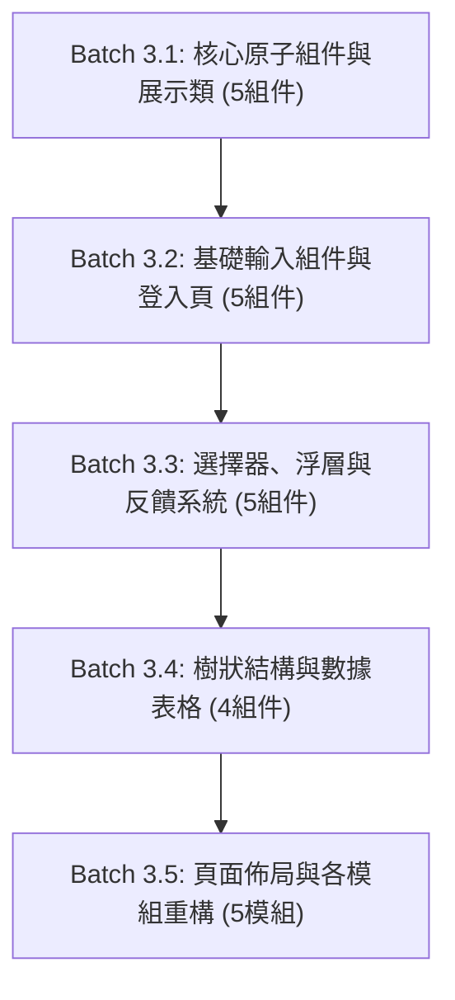

> [!CAUTION]
> **跨 Agent 執行嚴格指令：無論如何都必須先閱讀以下最新官方文件，嚴格禁止依賴模型過往訓練知識！**
>
> 1. **React Aria Components**: https://react-aria.adobe.com/llms.txt
> 2. **shadcn/ui (React Aria Base)**: https://ui.shadcn.com/llms.txt
> 3. **@shadcn/lint (Agent-First Linter)**: https://github.com/shadcn-ui/lint
> 4. **TanStack Form (Type-Safe Forms)**: https://tanstack.com/form/latest

# Phase 3 執行手冊：由底而上分批次組件遷移

## 1. 階段目標與核心理念

本階段為遷移的**核心實施階段**。依循使用者指示，嚴格貫徹「**一次 3~5 個組件、由底而上 (Bottom-Up)、降低程式碼漂移**」的原則。

每個批次皆必須具備高內聚性，且在每批次完成後，**必須立即執行 `vpr agent:verify:gate`**，以確認該批次改動零破壞、測試全數綠燈，再進行下一批次。

---

## 2. 批次遷移藍圖總覽



---

## 3. 各批次詳細遷移規範

### Batch 3.1: 核心展示與原子組件 (Atoms & Display)

- **目標組件清單（5 個）**：
  1. `ui/button.tsx`：RAC `Button` + `cva` variants (`default`, `destructive`, `outline`, `ghost`, `link`) 與 sizes (`sm`, `md`, `lg`)，支援 `data-[hovered]`, `data-[pressed]`, `data-[disabled]` 狀態。
  2. `components/PermissionButton.tsx`：將原本 Antd Button 改為封裝上述 RAC Button，維持 RBAC 權限判斷（無權限時 `hide` 或 `disable`）。
  3. `ui/badge.tsx`：取代 Antd `Tag`，提供 `default`, `primary`, `success`, `error`, `gold` 等語意色彩變體（用於 UserTable 的狀態與 System 標籤）。
  4. `ui/card.tsx`：純 Tailwind v4 卡片組件（`Card`, `CardHeader`, `CardTitle`, `CardDescription`, `CardContent`, `CardFooter`）。
  5. `components/I18nSwitcher.tsx` & `src/client/constants/routes.tsx`：
     - `I18nSwitcher`：使用 RAC `MenuTrigger`, `Menu`, `MenuItem`, `Popover` 替換 Antd Dropdown，並以 `lucide-react` 的 `Globe` 替換 `GlobalOutlined`。
     - `constants/routes.tsx`：將選單項目的 Antd 圖示 (`ApartmentOutlined`, `SafetyCertificateOutlined`, `TeamOutlined`) 替換為 `lucide-react` 的 `Network`, `ShieldCheck`, `Users`。
- **驗證指標**：
  - `vpr agent:test:e2e` 確保 `test/client/e2e-i18n.test.tsx` 與既有 RBAC 測試順利通過。

> [!TIP]
> **Batch 3.1 移交確認**：`Button`, `PermissionButton`, `Badge`, `Card`, `I18nSwitcher` 與 `routes.tsx` 圖示已無 Antd 依賴，`vpr agent:verify:gate` 100% 通過。
>
> **Batch 3.2 啟動 Prompt**：
>
> ```markdown
> 請繼續執行前端遷移 Phase 3 的 Batch 3.2（基礎輸入組件與登入頁面）。
> 請閱讀 `docs/migration/phase3_bottom_up_component_migration.md` 中 Batch 3.2 規範。
> 目標：實作 `ui/textfield.tsx`（含 TextArea）、`ui/password-input.tsx`、`ui/number-field.tsx`、`ui/radio-group.tsx`，並將 `src/client/routes/login.tsx` 重構為 TanStack Form。
> 完成後執行 `vpr agent:verify:gate` 確保全綠。
> ```

---

### Batch 3.2: 基礎輸入組件與登入頁面 (Inputs & Login Flow)

- **目標組件清單（5 個）**：
  1. `ui/textfield.tsx` (`ui/input.tsx`)：RAC `TextField`, `Input`, 以及 `TextArea`（供角色描述欄位使用）。
  2. `ui/password-input.tsx`：帶有 `lucide-react` `Eye` / `EyeOff` 切換的密碼輸入框。
  3. `ui/number-field.tsx`：RAC `NumberField`, `Group`, `Input`, `Button`（供部門與角色表單的「排序」欄位使用）。
  4. `ui/radio-group.tsx`：RAC `RadioGroup`, `Radio`（供人員狀態與角色資料範圍選擇）。
  5. **頁面重構**：`src/client/routes/login.tsx`：
     - 移除 Antd `Form`, `Input`, `Button`, `Card`。
     - 採用 TanStack Form 綁定 `LoginReqSchema`，並以上述組件渲染。
- **驗證指標**：
  - `vpr agent:test:e2e` 確保登入流程與 Wire Contract 測試 100% 通過。

> [!TIP]
> **Batch 3.2 移交確認**：登入頁已切換為 TanStack Form + RAC，`canary.test.tsx` 與登入測試通過，`vpr agent:verify:gate` 100% 通過。
>
> **Batch 3.3 啟動 Prompt**：
>
> ```markdown
> 請繼續執行前端遷移 Phase 3 的 Batch 3.3（選擇器、浮層與反饋系統）。
> 請閱讀 `docs/migration/phase3_bottom_up_component_migration.md` 中 Batch 3.3 規範。
> 目標：實作 `ui/select.tsx`（含 MultiSelect）、`DataModal.tsx`、`DataDrawer.tsx`、`ui/popconfirm.tsx`，以及以 RAC `ToastQueue` 實作的 `ui/toast.tsx`，並在 `providers.tsx` 掛載 `<ToastRegion>`。
> 完成後執行 `vpr agent:verify:gate` 確保全綠。
> ```

---

### Batch 3.3: 選擇器、浮層與反饋系統 (Selects, Overlays & Feedback)

- **目標組件清單（5 個）**：
  1. `ui/select.tsx`：
     - 單選：RAC `Select`, `Button`, `SelectValue`, `Popover`, `ListBox`, `ListBoxItem`。
     - 多選：封裝 `MultiSelect` / `TagPicker`（供 `UserModal` 選擇多個角色 `roleIds` 使用）。
  2. `components/common/DataModal.tsx`：使用 RAC `ModalOverlay`, `Modal`, `Dialog` 封裝，相容原有 `open`, `title`, `onCancel`, `onOk`, `confirmLoading` 介面，並以 `lucide-react` `X` 作為關閉按鈕。
  3. `components/common/DataDrawer.tsx`：使用 RAC `Sheet` 或右側 slide-in `Modal` 實作右側滑出抽屜，相容 `open`, `title`, `onClose`, `extra` 介面。
  4. `ui/popconfirm.tsx`：使用 RAC `DialogTrigger` + `Popover` + `Button` 封裝氣泡確認框，相容原有確認/取消行為。
  5. `ui/toast.tsx` (`src/client/utils/toast.ts`)：
     - 封裝基於 RAC `ToastQueue` 的通知浮層系統，在 `src/client/providers.tsx` 掛載 `<ToastRegion>`。
     - 替換 React Query 與 hooks 中對 Antd `App.useApp().message.error()` 與 `message.success()` 的依賴。
- **驗證指標**：
  - 驗證 Modal 開啟、抽屜滑出、Popconfirm 氣泡點擊、Toast 彈出皆符合原本行為。

> [!TIP]
> **Batch 3.3 移交確認**：浮層與反饋系統皆已就緒且相容既有調用，Toast 通知正常，`vpr agent:verify:gate` 100% 通過。
>
> **Batch 3.4 啟動 Prompt**：
>
> ```markdown
> 請繼續執行前端遷移 Phase 3 的 Batch 3.4（樹狀結構與數據表格）。
> 請閱讀 `docs/migration/phase3_bottom_up_component_migration.md` 中 Batch 3.4 規範。
> 目標：實作可勾選之階層樹 `ui/tree.tsx`、下拉選擇器 `ui/tree-select.tsx`，並結合 `@tanstack/react-table` 與 RAC Table 打造 `DataTable.tsx` 與樹狀展開表格 `DepartmentTreeTable.tsx`。
> 完成後執行 `vpr agent:verify:gate` 確保全綠。
> ```

---

### Batch 3.4: 樹狀結構與數據表格 (Trees & Tables)

- **目標組件清單（4 個）**：
  1. `ui/tree.tsx`：使用 RAC `Tree` (v1.7+) + `Checkbox` 實作可勾選的多選階層樹，用於 `RoleDrawer` 中的權限樹勾選 (`PermissionTreeInput`)。
  2. `ui/tree-select.tsx`：使用 RAC `Popover` + RAC `Tree` 自製下拉樹狀選擇器，支援部門階層單選（上級部門）與多選（自訂資料權限之自訂部門）。
  3. `components/common/DataTable.tsx`：結合 RAC `Table` 與 `@tanstack/react-table`，維持 `max-content` 響應式橫向捲動、分頁與選取邏輯，預設 `rowKey="id"`。
  4. `components/department/DepartmentTreeTable.tsx`：基於 TanStack Table 樹狀展開結構 (`getSubRows`) 實現部門階層展開與摺疊，搭配 `ChevronRight` / `ChevronDown` 圖示。
- **驗證指標**：
  - `test/client/e2e-departments.test.tsx` 樹狀層級展示與選取完全綠燈。

> [!TIP]
> **Batch 3.4 移交確認**：數據表格與階層樹全部通過瀏覽器 E2E 測試驗證，`vpr agent:verify:gate` 100% 通過。
>
> **Batch 3.5 啟動 Prompt**：
>
> ```markdown
> 請繼續執行前端遷移 Phase 3 的 Batch 3.5（頁面佈局與各模組重構）。
> 請閱讀 `docs/migration/phase3_bottom_up_component_migration.md` 中 Batch 3.5 規範。
> 目標：重構 `Layout.tsx` 為標準語意 HTML5 + Tailwind 導航；重構 Department, Role, User 業務頁面與對應 Modal/Drawer；重構 403 頁面與首頁空看板；將所有 Antd `<Flex>` 與 `<Space>` 替換為 Tailwind 工具類。
> 完成後執行 `vpr agent:verify:gate` 確保全站業務功能零退化。
> ```

---

### Batch 3.5: 頁面佈局與各模組重構 (Layout & Management Views)

- **目標組件清單（5 個模組/頁面）**：
  1. `components/Layout.tsx`：
     - 移除 `AntdLayout`, `Header`, `Sider`, `Menu`, `Typography`。
     - 使用標準 `<header>`, `<aside>`, `<main>` 配合 Tailwind v4 打造響應式側邊導航，Icon 全面採用 `lucide-react` (`Users`, `ShieldCheck`, `Network`, `LogOut`, `Menu`, `ChevronLeft`, `ChevronRight`)。
  2. `src/client/routes/departments.tsx` & `components/department/DepartmentModal.tsx`：切換為 TanStack Form + RAC Modal/NumberField/TreeSelect。將所有 Antd `<Flex>` 與 `<Space>` 替換為 Tailwind Flex 工具類別。
  3. `src/client/routes/roles.tsx` & `components/role/*`：切換為 TanStack Form + RAC Drawer/Table/Tree。
  4. `src/client/routes/user.tsx` & `components/user/*`：切換為 TanStack Form + RAC Modal/Table/MultiSelect。
  5. `src/client/routes/403.tsx` & `src/client/routes/index.tsx`：
     - `403.tsx`：以純 Tailwind 卡片與 `ShieldAlert` 圖示重構，移除 Antd `Result`。
     - `index.tsx`：以純 Tailwind 居中容器展示系統 Logo 與灰階空看板，移除 Antd `Empty`。
- **驗證指標**：
  - 執行全站 E2E 測試，確保所有業務管理頁面功能無損。

---

## 4. Phase 3 驗收標準 (Acceptance Gate)

完成所有批次後，專案原始碼中除未移除的過渡依賴外，業務頁面已無任何 Antd 組件呼叫：

```bash
# 驗收門禁
vpr agent:verify:gate
```

驗收合格後，Phase 3 Agent 即可將代碼移交至 Phase 4 進行依賴清理與規範收束。

---

## 5. 階段結束確認事項與 Phase 4 啟動指令 (Handover & Next Phase Activation)

### 5.1 移交前確認事項 (Pre-flight Checklist)

請在結束當前 Phase 3 對話前，逐一核對以下檢查項目：

- [ ] 5 個 Batch 的組件與頁面皆已全數替換為 RAC + TanStack Form + Tailwind v4。
- [ ] 業務頁面（`routes/` 與 `components/`）已無任何使用中的 Antd 組件（如 `Button`, `Form`, `Table`, `Modal`, `Drawer`, `Select`, `Input`, `TreeSelect`, `Card`, `Flex`, `Space`, `Result`, `Empty`）。
- [ ] 全域 Toast 系統已接管所有通知需求。
- [ ] 執行 `vpr agent:verify:gate`，所有單元與 E2E 測試 100% 綠燈通過。
- [ ] 產生英文 Conventional Commit 建議並由使用者在本地終端機完成提交。

### 5.2 Phase 4 啟動 Prompt (供使用者複製至全新 Agent 對話)

```markdown
請擔任前端現代化遷移的 Phase 4 負責 Agent。

請先依序閱讀以下文件以建立上下文：

1. `docs/migration/README.md`
2. `docs/migration/phase4_enforcement_and_cleanup.md`
3. 官方最新文件：https://github.com/shadcn-ui/lint

【當前狀態】
Phase 1、Phase 2 與 Phase 3（5 個 Batch）已全數完成，所有業務頁面皆已現代化，E2E 測試 100% 綠燈。

【本次任務目標】
執行 Phase 4「嚴格守門、清理與文檔收尾」：

1. 將 `.oxlintrc.json` 中的 `@shadcn/lint` 規則等級正式提升為 `error`。
2. 徹底卸載套件：`vp remove antd @ant-design/icons`。
3. 刪除與簡化過渡檔案：
   - 刪除 `src/client/hooks/useAntdForm.ts`。
   - 清理 `src/client/hooks/useI18n.ts`（移除 `antdLocales` 與 Antd 語系引入）。
   - 簡化 `src/client/theme.ts`（移除 `createAntdTheme`、`useAntdTheme` 與 `MutationObserver`）。
   - 簡化 `src/client/providers.tsx`（移除 `AntdProvider`, `ConfigProvider`, `App` 並掛載 `ToastRegion`）。
4. 適配 `test/client/canary.test.tsx`（測試對象轉移至 RAC Button）。
5. 同步專案規範文件（`AGENTS.md`, `.agents/rules/ui-styling.md`, `.agents/skills/scaffold-feature/SKILL.md`）。
6. 通過全門禁驗證後，刪除 `docs/migration/` 目錄。
```
